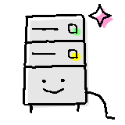

# your notes are already a blog!

Point uses.ink at a repo or a vault and you get a blog at your own address. Your files stay right where they are.

`github.com/you/notes` [publish it](https://github.com/uses-ink/uses.ink/blob/main/docs/selfhost.md)

*no config file, no build step. promise!*


---


## then it tells you what it figured out!

uses.ink reads your files the way you left them and writes every guess down next to its reason. Nothing hides behind a setting. `ink explain` prints the list.

- *home page! the only file at the top*
  
  `README.md`
- *a post, dated from git*
  
  `shelves.md`
- *titled from its first heading*
  
  `rust-traits.md`
- *drafts are sleeping. not published*
  
  `drafts/`
- *app settings, skipped*
  
  `.obsidian/`

> disagree with a guess? pin it in your repo, or let `ink pin` write it:
>
> ```toml
> # ink.toml
> exclude = ["wip/**"]
> ```

---

## it reads what you already use.

- 
  **a git repo**
  GitHub, Codeberg, GitLab or any git remote over https. Push like always and the blog follows.
  *any forge works, or none!*
- 
  **a folder**
  Run `ink push` in any folder of markdown. No git needed.
  *one command, done*
- 
  **an Obsidian vault**
  Wikilinks and embeds work.
  *only the notes you pick get out*

---

## and your readers get a lovely little page.

- [x] no JavaScript, no cookies, no account
- [x] a feed for every list of posts
- [x] your own domain, if you have one

> [!NOTE] you.uses.ink/shelves
> **Notes on building shelves**
>
> 2 March 2026, 4 minute read
>
> The wood is pine and every cut is a little wrong. Measuring twice did not help; measuring with the same tape twice might have.
>
> Next time: oak, a square that is actually square, and a pilot hole before every screw.

---

## and it stays yours.

- 

  **leave whenever**

  Your files never moved, so there is nothing to export. Unplug uses.ink and your notes are exactly where you left them.

- 

  **or run it yourself**

  One binary, on your own box. The [self-host guide](https://github.com/uses-ink/uses.ink/blob/main/docs/selfhost.md) has the install, backups and upgrades.

  ```
  $ ink serve --data ./state
  ```

---

## go on, publish your notes!

`github.com/you/notes` [publish it](https://github.com/uses-ink/uses.ink/blob/main/docs/selfhost.md)

uses.ink is pre-release and the hosted service is not open yet. The button opens the self-host guide, which is how you publish today.

---

open source. your notes not included.

[github](https://github.com/uses-ink) [roadmap](https://github.com/uses-ink/uses.ink/blob/main/docs/roadmap.md) [self-host](https://github.com/uses-ink/uses.ink/blob/main/docs/selfhost.md)
